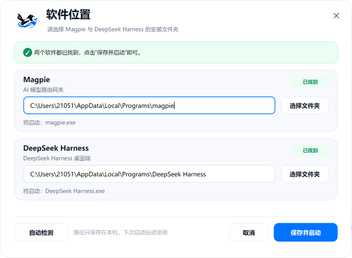

<div align="center">

<a href="https://github.com/likou123/MagDsh"></a>

# MagDsh

### Magpie in the tray. DSH in front.
</div>

<p align="center">
  <strong>一个安静的Windows启动器</strong><br>
  先让Magpie驻留托盘，再把DeepSeek Harness带到前台。
</p>

<p align="center">
  <a href="https://github.com/likou123/MagDsh/releases/latest"></a>
  
  <a href="LICENSE"></a>
</p>

---

**MagDsh**把两个经常一起使用的工具合成一次点击：

1. 以官方`tray`模式启动**Magpie**，只驻留托盘，不弹出主界面；
2. 启动**DeepSeek Harness (DSH)**，等窗口出现后把它带到前台；
3. 启动器自己关闭。

## 它解决什么

- **桌面不再被Magpie主界面挡住**：Magpie只在托盘里工作。
- **DSH始终是最后的前台窗口**：不会启动完又跳回Magpie。
- **不同安装方式都能找到**：优先读取安装注册表、App Paths和运行中进程，再回退到默认目录、PATH、Scoop/winget/Chocolatey目录。
- **不用每次选路径**：自动检测安装目录，找不到时引导选择并记住。
- **不弹UAC**：以当前用户权限运行，不请求管理员权限。
- **尺寸稳定**：在Windows 125%等缩放下，UI不会整体放大。


## 下载

<p align="center">
  <a href="https://github.com/likou123/MagDsh/releases/download/v1.1.1/MagDsh.exe"></a>
</p>

Windows x64单文件，不需要安装Python。首次运行未签名程序可能触发SmartScreen，选择**更多信息 → 仍要运行**即可。

<details>
<summary>SHA256</summary>

```text
6f090aa5ff7684f00eefac6be7de3a10e0781079d998aeb497f7b9eb2a3e978d
```

</details>

## 界面

<p align="center">
  
</p>

<p align="center"><sub>软件位置窗口·700×512</sub></p>

## 使用

把`MagDsh.exe`放在任意目录，双击运行。默认查找：

```text
Magpie              %LOCALAPPDATA%\Programs\magpie
DeepSeek Harness    %LOCALAPPDATA%\Programs\DeepSeek Harness
```

路径不同时会弹出“软件位置”窗口；选择两个文件夹后，路径会保存在：

```text
%LOCALAPPDATA%\MagDsh\settings.ini
```

### 命令行

| 参数 | 作用 |
|---|---|
| 无参数 | 自动检测并启动 |
| `--settings` / `-s` | 强制打开软件位置窗口 |
| `--help` / `/?` | 显示帮助 |

## 从源码构建

要求Windows 10/11 x64、Python 3.11+、PowerShell 5.1+。

```powershell
cd source\build
python -m venv ..\.venv
..\.venv\Scripts\python.exe -m pip install -r requirements.txt
powershell -ExecutionPolicy Bypass -File .\build.ps1
```

脚本会生成`source\build\MagDsh.exe`，并复制到项目根目录。

<details>
<summary>目录结构</summary>

```text
MagDsh/
├─ README.md
├─ LICENSE
├─ third_party_notices.md
├─ MagDsh.exe                 本地构建产物（不提交到Git）
└─ source/
   ├─ build/
   │  ├─ build.ps1
   │  ├─ requirements.txt
   │  ├─ run_magdsh.py
   │  └─ MagDsh.exe
   ├─ src/magdsh/
   │  ├─ __main__.py
   │  ├─ appinfo.py
   │  ├─ launcher_form.py
   │  ├─ settings_form.py
   │  ├─ widgets.py
   │  ├─ theme.py
   │  ├─ dialogs.py
   │  └─ assets/
   ├─ shots/
   └─ 图标/
```

</details>

## 工作方式

1. 解析Magpie和DSH的可执行文件路径；
2. 以各自安装目录为工作目录，用`subprocess.Popen`启动Magpie；
3. Magpie参数为`tray`，主窗口不显示；
4. 延迟启动DSH；
5. 通过Win32`ShowWindowAsync` / `SetForegroundWindow`将DSH恢复到前台；
6. 启动器自动关闭。

启动器不会修改Magpie或DSH的安装文件，也不会自动提权。

## 说明

- **Magpie和DSH不是本项目的一部分**，需要单独安装；它们的许可证、更新和配置由各自项目负责。
- 支持默认安装、系统级安装、Magpie自定义安装目录、Scoop/winget/Chocolatey，以及运行中的便携版；完全未知的便携目录可在“软件位置”窗口手动选择。
- 本项目只负责启动与路径选择，不代理模型请求，也不保存API Key。
- 配置和日志位于`%LOCALAPPDATA%\MagDsh\`。

## 更新日志

见 [CHANGELOG.md](CHANGELOG.md)。1.1.1 主要增加了多安装方式的自动发现。

## License

[MIT](LICENSE) © 2026 MagDsh contributors

第三方依赖和运行时组件见[third_party_notices.md](third_party_notices.md)。
